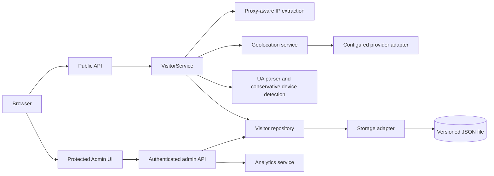

# RAKIB IP Intelligence System V2 — Architecture

## Phase A proposal

The rebuild is isolated under `rebuild/`. The existing root application, deployment settings, database records, and backup files are not replaced or started by this project.

## Request and data flow

## Modules

- `src/config.js`: validates environment configuration and trusted proxy hops.
- `src/lib/`: input normalization, safe logging, rate limiting, and IP helpers.
- `src/geolocation/`: provider interface, `ipwho.is` adapter, normalization, coalescing, bounded cache, retries, and classified failures.
- `src/device/`: User-Agent parser adapter and conservative model fallback.
- `src/services/visitorService.js`: orchestrates IP, geo, device, browser-supplied signals, and persistence independently.
- `src/db/jsonFileRepository.js`: versioned file repository with validation, serialized writes, atomic replacement, and the repository contract used by the app.
- `src/db/storage.js`: storage-adapter factory. V2 normal startup selects only the JSON-file backend and never imports or connects to MongoDB.
- `src/db/mongoRepository.js`: isolated MongoDB adapter retained for future reintroduction and adapter-specific tests; it is not imported by the normal server bootstrap.
- `src/auth/`: password verification, signed short-lived admin sessions, and server-side authorization middleware.
- `src/lib/rateLimit.js`: process-local per-IP limit buckets with bounded LRU memory and periodic expiry cleanup.
- `src/services/adminAnalytics.js`: bounded aggregation for overview, geography, device, browser, and OS summaries.
- `src/routes/`: public and admin API contracts, validation, and authorization.
- `src/app.js`: dependency-injected Express app; tests use mocks and do not connect to MongoDB.
- `src/server.js`: production bootstrap; initializes the configured storage adapter, services, and routes without MongoDB configuration.
- `public/`: separate public and admin experiences with mobile-first styles and no third-party UI framework.
- `test/`: Node's built-in test runner, fake repositories, mocked provider responses, and HTTP-level tests.

## Persistence and legacy compatibility

The active repository stores `{ version: 1, records: [...] }` in `STORAGE_FILE`. It validates the format and record identifiers on every read, rejects plaintext IP fields, serializes concurrent same-process inserts, fsyncs a mode-0600 temp file, atomically renames it, syncs the containing directory, and acquires an exclusive `${STORAGE_FILE}.lock` to reject a second process. In production, config requires `STORAGE_MOUNT_PATH`, confines the data file to that mount, and storage bootstrap confirms the mount exists before creating or opening the file. Corrupt or unknown-version data is not overwritten. Closed repository objects reject further operations after releasing their lock. Stale locks are preserved for manual recovery after confirming the owning process stopped. The Mongo adapter remains independent for later use and is not part of normal startup.

`src/db/storageBackup.js` provides a separate CLI-facing service. It snapshots a validated versioned JSON file to timestamped data plus a manifest containing byte size, storage format version, timestamp, and SHA-256. Temp files are synced and hard-linked into unique final names without replacement; the manifest is committed last and the final pair is reread and verified. An exclusive backup operation lock serializes create/restore/retention operations. Retention removes only older verified backup pairs, keeps at least one newest verified backup, and ignores incomplete/corrupt artifacts. Restore requires explicit caller confirmation, refuses any existing app lock, takes the app lock as a maintenance lock, writes a recovery copy, verifies a staged temp file, and atomically renames it over live storage. Recovery artifacts do not enter automated retention.

## Public and admin boundaries

- The public intelligence route returns the requesting visitor's own IP/device/approximate geo result; it cannot query another visitor's record.
- Public history uses an allowlist serializer and returns only a masked IP, coarse location, and timestamp.
- Other visitors' device/browser details, full IPs, precise coordinates, network provider fields, provider health, analytics, export, and SSE require a valid server-side admin session.
- Admin cookies are `HttpOnly`, `SameSite=Strict`, and `Secure` in production. Admin writes check same-origin requests. Login is rate-limited.

## Runtime contract

Node.js 20.18.1 or newer, Express 5, `ua-parser-js` 2, and dotenv are used by normal startup. The MongoDB driver is a development dependency for the dormant adapter and its tests; the Render build omits development dependencies and `src/server.js` does not import it. The normal boot path works without MongoDB variables or a database connection. The public app can be exercised without MongoDB. The Render configuration is kept inside this directory so the root deployment remains unchanged. The V2 blueprint now declares a disk at `/var/data`, but account eligibility, dashboard provisioning, and deployment are not verified. Production startup fails closed if the configured mount is absent.

## Phase gates

1. Inspection and this architecture proposal (complete).
2. Implement public app, protected admin app, modular services, API contracts, and documentation under `rebuild/`.
3. Run unit and mocked HTTP tests; never use production records in tests.
4. Use an available browser runner for responsive checks; report honestly if none is available.
5. Leave the root production app in place. Replacing it requires separate explicit approval after review.
